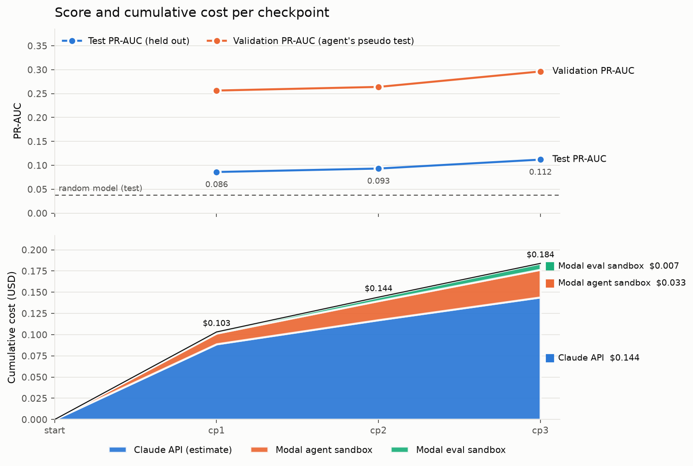

# Run 20261017-072356-olist

`claude-sonnet-5-5` · effort `low` · 3 iterations · 3 checkpoints verified · agent sandbox 2.6 min

**Total cost $0.184**: Claude API $0.144 (estimate), Modal $0.040 (estimate).
**Best test PR-AUC 0.112** at checkpoint 3 (random model: 0.0378).

| cp | change | val PR-AUC | test PR-AUC | test ROC-AUC | cost | cumulative |
|---|---|---|---|---|---|---|
| 1 | minimal baseline, default LightGBM on 9 order-level features | 0.2564 | **0.0861** | 0.7125 | $0.103 | $0.103 |
| 2 | added seller-customer geo features (max/mean haversine distance, same-state flag) | 0.264 | **0.0933** | 0.725 | $0.041 | $0.144 |
| 3 | regularized LightGBM (300 trees, lr 0.03, 15 leaves, min_child 50, subsampling, L2=5) | 0.2963 | **0.112** | 0.7544 | $0.040 | $0.184 |

Per-checkpoint details: `checkpoints/cp_<k>/CHECKPOINT_REPORT.md` (scores, deltas, cost, agent's note, code diff).

## Agent's final report

# Final report
## Approach
LightGBM classifier on order-level features, trained on all labelled orders (train.py), shared feature code in feats.py.
## Features (all known at purchase time; each row uses only its own order plus static lookup tables)
- Items: count, total price, total freight, number of sellers.
- Promised delivery days (estimated date minus purchase time); purchase day of week, hour, month.
- Customer state.
- Geo: max/mean haversine distance seller-to-customer (median coordinates per zip prefix), same-state flag.
No labels, delivery dates or cross-order aggregates are used as inputs.
## Validation (last 20% of orders held out; PR-AUC)
- Iter 1 baseline default LightGBM: 0.2564 (ROC 0.6494, Brier 0.1345)
- Iter 2 + geo features: 0.2640 (ROC 0.6529, Brier 0.1343)
- Iter 3 regularized LightGBM: 0.2963 (ROC 0.6799, Brier 0.1328)
## Known weaknesses
- Held-out late rate (15.7%) is double the overall 7.8%, so there is drift; scores are only a guide.
- No seller/product history features (seller historical late rate, product weight/volume, category), and no hyperparameter search.
- Month feature may extrapolate poorly to unseen periods.

