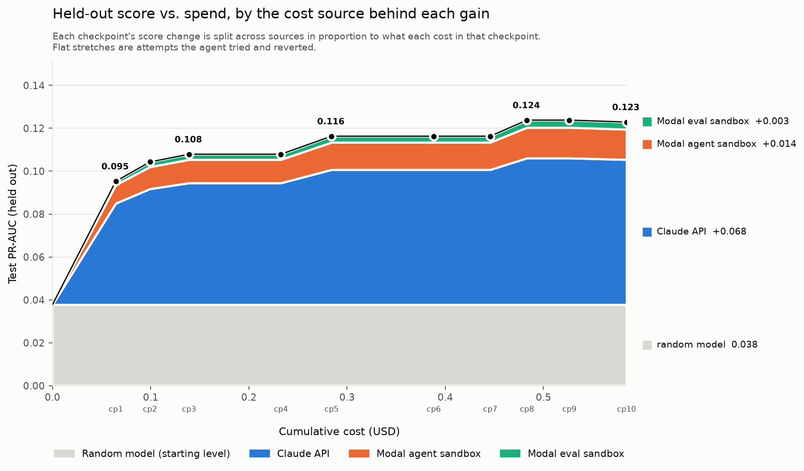

# Run 20261017-080829-olist

`claude-sonnet-5-5` · effort `low` · 10 iterations · 10 checkpoints verified · agent sandbox 9.1 min

**Total cost $0.585**: Claude API $0.445 (estimate), Modal $0.139 (estimate).
**Best test PR-AUC 0.1238** at checkpoint 8 (random model: 0.0378).

| cp | change | val PR-AUC | test PR-AUC | test ROC-AUC | cost | cumulative |
|---|---|---|---|---|---|---|
| 1 | Minimal baseline, default LightGBM on 7 order-level features. | 0.2051 | **0.0953** | 0.7097 | $0.064 | $0.064 |
| 2 | Added seller features (seller state of first item, same-state flag, number of sellers). | 0.2205 | **0.1043** | 0.7363 | $0.035 | $0.099 |
| 3 | Added seller-to-customer haversine distance (km) from mean geolocation per zip prefix. | 0.2184 | **0.1079** | 0.7454 | $0.040 | $0.139 |
| 4 | Tried product features (first-item category, total weight, max volume); reverted. | 0.2184 | **0.1079** | 0.7454 | $0.093 | $0.233 |
| 5 | Added payment features (max installments, total payment value, number of payments, main payment type). | 0.2171 | **0.1163** | 0.7478 | $0.052 | $0.284 |
| 6 | Tried past-only seller history (seller order count and smoothed late rate, using only orders delivered before each purchase); reverted from FEATS. | 0.2171 | **0.1163** | 0.7478 | $0.104 | $0.388 |
| 7 | Tried calendar features (purchase month, day of month, promised-date weekday); reverted from FEATS. | 0.2171 | **0.1163** | 0.7478 | $0.058 | $0.446 |
| 8 | Regularized LightGBM (300 trees, lr 0.02, 15 leaves, min_child_samples 100, subsampling, L2 5) instead of defaults. | 0.2318 | **0.1238** | 0.7688 | $0.037 | $0.483 |
| 9 | Retried product size features without category (total weight, max package volume); reverted from FEATS. | 0.2318 | **0.1238** | 0.7688 | $0.043 | $0.526 |
| 10 | Averaged 5 LightGBM models trained with different random seeds. | 0.232 | **0.1229** | 0.7675 | $0.058 | $0.585 |

Per-checkpoint details: `checkpoints/cp_<k>/CHECKPOINT_REPORT.md` (scores, deltas, cost, agent's note, code diff).

## Agent's final report

# Final report

## Approach
One row per order. Features are built in `features.py` from the order, its items, payments, customer, seller and geolocation tables. A LightGBM classifier (regularized, 5-seed average) predicts `p_late`. `train.py` fits and saves the models; `predict.py` rebuilds the same features and averages the models.

## Final features (all known at purchase time, using only the order itself)
- n_items, price sum, freight sum, n_sellers
- est_days: promised delivery date minus purchase time (the promise is made at purchase)
- purchase hour and weekday
- customer_state, seller_state (first item), same_state flag
- dist_km: seller to customer haversine distance, from mean coordinates per zip prefix in `geolocation.csv`
- payment: max installments, total payment value, number of payments, main payment type

No label, delivery date or other post-purchase column is used as a model input. No feature uses other orders in the file being predicted. `train_labels.csv` is only read as the training target. Nothing is hardcoded.

## Model
LightGBM: 300 trees, lr 0.02, 15 leaves, min_child_samples 100, subsample 0.8, colsample 0.7, L2 5, 5 seeds averaged. Training takes a few seconds, prediction about 2 seconds.

## Validation (pseudo test, last 20% of orders; positive rate 11.9%)
| iter | change | PR-AUC | decision |
|---|---|---|---|
| 1 | baseline, 7 features, default LGBM | 0.2051 | kept |
| 2 | seller state, same-state, n_sellers | 0.2205 | kept |
| 3 | seller-customer distance | 0.2184 | kept (within noise) |
| 4 | product category, weight, volume | 0.2138 | reverted |
| 5 | payment features | 0.2171 | kept (ROC-AUC up) |
| 6 | past-only seller history | 0.2048 | not used |
| 7 | month, day of month, est weekday | 0.1779 | not used |
| 8 | regularized LightGBM | 0.2318 | kept |
| 9 | weight, max volume only | 0.2289 | not used |
| 10 | 5-seed averaging | 0.2320 | kept |

Final pseudo-test scores: PR-AUC 0.2320, ROC-AUC 0.6808, Brier 0.1044.

## Known weaknesses
- Signal is weak overall (ROC-AUC about 0.68). Most lateness comes from carrier events we cannot see at purchase.
- Pseudo-test differences of about 0.002 are within noise (about 1.5k positives), so iterations 3 and 5 were kept on plausibility, not clear gains.
- Distribution shift: the training snapshot lacks late orders still in transit, and the late rate in the later period differs (6.9% overall vs 11.9% in the last 20%). Probabilities are likely under-calibrated for the test period.
- Time-based features (month) and history features (seller late rate) hurt, so the model has no information about seller track record or seasonality. A better history feature (out-of-fold, matched between train and test) is the main untried idea.
- Dead helper code (`hist_train`, `hist_apply`) remains in `features.py`; its output columns are not in `FEATS`.
- Hyperparameters were hand-picked, not searched.

